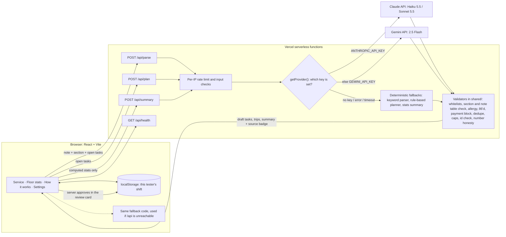

# Waiterly: Project Summary

**Live:** https://waiterly.vercel.app (public, no sign-in) · **Code:** https://github.com/tshusanta/waiterly
CIS 3100, Application of Generative AI. "Business AI Innovation Challenge" final project. All data is synthetic.

> **Current mode: FALLBACK MODE.** No AI key is configured yet, so the live app organizes notes with a keyword parser, plans trips with rules, and writes the manager summary from the stats. The FALLBACK MODE badge says so on every page. Adding `ANTHROPIC_API_KEY` (or `GEMINI_API_KEY`) in Vercel switches on the AI with no code change ([ADD_API_KEY_LATER.md](ADD_API_KEY_LATER.md)). Real-model test results are PENDING ([TEST_RESULTS.md](TEST_RESULTS.md) §3).

---

## Problem

Restaurant servers take spoken requests from several tables at once: water refills, sauces, split checks, to-go boxes, allergy questions. They keep these in their heads or on scraps of paper. That leads to four problems:
- requests get forgotten;
- servers make extra trips;
- guests wait longer;
- managers can't see where service slows down.

An allergy question that gets lost or answered casually is a safety risk, not just a service miss.

## Solution

The server types or dictates one messy note, for example *"table 1 needs two waters and napkins, 4 wants ranch, seven is ready for the check split three ways"*.

1. **The AI organizes it** into short, prioritized tasks per table. Allergies are flagged and sent to the kitchen, sold-out items become "tell the guest" tasks, unclear requests come back as questions, and anything outside the section or not a guest request is rejected.
2. **The server reviews and approves.** Nothing is added without a tap, and every table and task text can be edited.
3. **Table cards** sort the work by priority and wait, with an amber "Waiting N min" after 5 minutes. A live tip and **Plan my next trips** group the work into at most 3 trips.
4. **Floor stats** give the manager KPIs, request charts, a time-stamped safeguard log and a shift summary built from the numbers only.

## Who it's for and the business value

| User | Value |
|---|---|
| Server | Fewer forgotten requests, fewer wasted trips, and one-handed capture during a rush |
| Guest | Shorter waits. Allergy questions always go to the kitchen. |
| Manager | Visibility: which tables and request types slow service, plus every safeguard that fired |

---

## Tech stack and why

| Tool | Why it was chosen |
|---|---|
| **React 19 + Vite + TypeScript** | Fast to build and test. Types are shared by the browser and the server, so the validation whitelists (categories, priorities, flags) are defined once. |
| **Plain CSS with design tokens** | Full control of the look (slate surfaces, one emerald accent, status-only amber and red) without a component kit's default style. See [DESIGN_RULES.md](DESIGN_RULES.md). |
| **IBM Plex Sans + Mono** (self-hosted, Latin only) | A readable operations-tool look. Mono's even-width digits keep wait timers aligned. Inter was avoided as the most common "AI-made" tell. |
| **Lucide icons, 1.5 px stroke** | Crisp and consistent. No emojis anywhere. |
| **Vercel serverless functions** (`/api`) | A public URL for the instructor, and **API keys stay server-side**. Free hosting. |
| **Claude via `@anthropic-ai/sdk`** | `claude-haiku-5-5` for fast, cheap structured parsing and planning. `claude-sonnet-5-5` for the manager's prose summary. Structured outputs enforce the JSON schema. |
| **Gemini via `@google/genai`** (alternative) | `gemini-2.5-flash` if only a Google key is available. Same prompts, schemas and validators. |
| **Deterministic fallbacks** | The app works with no key, during outages and on timeouts, and the spec forbids fake AI output, so the fallback is honest code. |
| **localStorage** | Each tester gets their own sandbox shift with no accounts and no stored personal data. "Reset shift" restores the sample. |
| **Vitest** | 84 unit and integration tests, including a fake model that misbehaves on purpose. |
| **Web Speech API** | Dictation where the browser supports it. The mic button is hidden elsewhere. |

---

## Architecture



**The key point:** every path, whether Claude, Gemini or fallback, goes through the **same validators** before the browser sees anything, and every task goes through the **server's approval** before it's added.

### Repository layout
```
api/            Vercel functions: parse, plan, summary, health (thin handlers, never return 500)
server/         prompt.ts (all prompts and schemas), provider.ts (env-var selection), providers/{anthropic,gemini,none}.ts
shared/         types, restaurant context, rules, validators, fallback parser and planner, stats, summary (used by browser and server)
src/            React app: views/, components/, state/ (localStorage), lib/ (API client, time, speech, suggestions)
tests/          endpoint integration tests (fake misbehaving model)
scripts/        run-scenarios.mjs (spec scenarios with PASS/FAIL), build-ai-design.mjs (writes prompts into AI_DESIGN.md)
docs/           this file, AI_DESIGN, TEST_RESULTS, RISKS_AND_LIMITATIONS, BUILD_LOG, DEMO_SCRIPT, DESIGN_RULES, ADD_API_KEY_LATER
```

---

## Run it locally

Requires Node.js 22 or newer (developed and tested on Node 26) and npm.

```bash
git clone https://github.com/tshusanta/waiterly.git
cd waiterly
npm install
cp .env.example .env     # optional: add ANTHROPIC_API_KEY or GEMINI_API_KEY; leave blank for FALLBACK MODE
npm run dev              # http://localhost:5173; the /api routes run locally through a Vite dev plugin
npm test                 # 84 unit + integration tests
npm run scenarios -- http://localhost:5173   # spec scenarios with automatic PASS/FAIL
```

**Deploy:** `npx vercel --prod` (the project is linked as `waiterly`). Set keys in Vercel → Project → Settings → Environment Variables, then redeploy.

## Related docs
- [AI_DESIGN.md](AI_DESIGN.md): every prompt word for word, schemas, models, validation, fallbacks
- [TEST_RESULTS.md](TEST_RESULTS.md): every scenario's input, expected and actual output, and pass/fail
- [RISKS_AND_LIMITATIONS.md](RISKS_AND_LIMITATIONS.md): risks, mitigations, and where humans stay in control
- [BUILD_LOG.md](BUILD_LOG.md): what was built, decisions, problems, and who did what
- [DEMO_SCRIPT.md](DEMO_SCRIPT.md): 3–5 minute demo walkthrough
